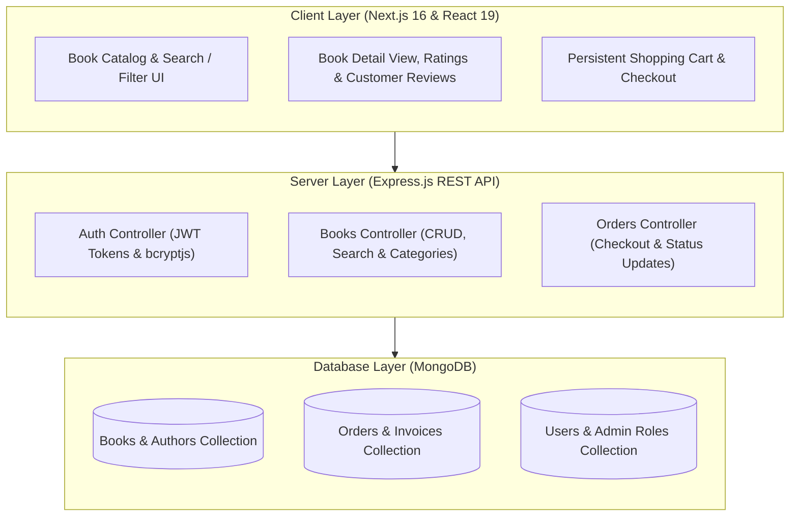

<div align="center">

<!-- Animated Header Wave Banner -->


<!-- Animated Typing SVG -->
<p align="center">
  
</p>

<!-- Tech Stack Badges -->
[](https://nextjs.org/)
[](https://react.dev/)
[](https://expressjs.com/)
[](https://www.mongodb.com/)
[](https://jwt.io/)
[](LICENSE)

<!-- Animated Skill Icons -->
<p align="center">
  
</p>

**[System Architecture](#-system-architecture)** • **[Features](#-key-features)** • **[API Documentation](#-api-endpoints)** • **[Local Setup](#-getting-started)**

</div>

---

## 🏛️ System Architecture



---

## ✨ Key Features

### 📚 Extensive Book Catalog & Search
- Filter books by genre (Fiction, Science, Technology, History, Self-Help).
- Live search by title, author name, or ISBN.
- Paginated results with sorting by price, popularity, and publication year.

### ⭐ Reviews & Rating System
- Verified customer reviews and 5-star ratings.
- Community feedback displayed on individual book pages.

### 🛒 Shopping Cart & Secure Checkout
- Add and adjust book quantities with instant price recalculation.
- Shipping address management and order confirmation receipts.
- Order history tracking in user profile.

### 🛡️ Secure Backend & Role-Based Access
- Robust **Express.js** REST API with centralized error handling.
- Password hashing with **bcryptjs** and token-based authentication via **JWT**.
- Admin permissions to manage inventory, update pricing, and fulfill orders.

---

## 🚀 Getting Started

### Prerequisites
- Node.js 18+ (or 20+)
- MongoDB Atlas connection string or local MongoDB instance

### Installation
```bash
git clone https://github.com/ga5e8je99/book-store.git
cd book-store
npm install
```

### Environment Configuration
Create a `.env` file in the root directory:
```env
PORT=5000
MONGO_URI=mongodb+srv://...
JWT_SECRET=your_jwt_secret_key
```

### Development
```bash
# Start backend server
npm run server

# In another terminal, start Next.js frontend
npm run dev
```

Visit [http://localhost:3000](http://localhost:3000) in your browser.

---

## 📄 License
This project is licensed under the MIT License.
